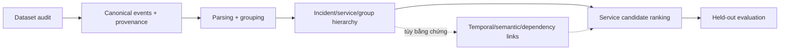

# Evidence-preserving Log Organization & Service-level RCA

Nghiên cứu offline về **tổ chức log phân cấp, giữ bằng chứng gốc và xếp hạng service nghi ngờ gây lỗi** trong microservices. Đây là working direction V3, cập nhật **23/10/2026**; tên đề tài, RQ và novelty chưa được Prof. Long phê duyệt.

Đọc [master context](NCKH_MASTER_CONTEXT_2026-10-23.md) trước khi làm việc. V1 WARNING-only/LLM Agent và V2 Failure Prediction được giữ trong [lịch sử](docs/history/resource_docs/README.md).

## Mục tiêu và nguyên tắc

Một incident tạo nhiều log lặp lại hoặc liên quan giữa các service. Đề tài hướng đến cấu trúc `incident → service → nhóm template/ngữ nghĩa → log gốc`, kèm candidate ranking và bằng chứng để kiểm tra.

- Giảm số mục cần xem ở tổng quan, giữ toàn bộ log nguồn và mapping truy ngược.
- Quan hệ temporal/semantic/dependency không tự chứng minh nhân quả.
- Đánh giá RCA ở mức service; không tự suy nhãn noise/root-cause cho từng log.
- Candidate phải thuộc inventory có nguồn. Split theo incident/nhóm case lặp, không dùng test labels làm input hoặc tuning.
- Không bắt buộc WARNING-only, autonomous Agent, failure prediction hoặc production dashboard.

## Pipeline và trạng thái thực tế



| Thành phần | Trạng thái ngày 23/10 |
| --- | --- |
| Ba adapters, CLI inspect/normalize, canonical schema | Có source trong `src/` |
| Raw metadata audit L0/L1 | Có artifact/script trong `scripts/audit/` (script) + `data/audit/` (artifact), ngày 20/10 |
| Chín Parquet chuẩn hóa | Có file; đã kiểm tra lại footer, chưa audit đầy đủ nội dung |
| Regex normalization + hash `template_id` | Có; chưa phải Drain3/Spell hoặc semantic clustering |
| Grouping/hierarchy/evidence graph/ranker V3 | Chưa tìm thấy implementation trong source active |
| Top-k, grouping metrics, user study | Chưa có kết quả V3 được xác nhận |

Xem [implementation status](docs/status/implementation_status.md) và [validation report](docs/status/validation_report.md). Số dòng canonical hiện có: RCAEval **5,272,618**, Nezha **71,173** (LEMMA-RCA đã bỏ khỏi dự án ngày 26/10/2026). Đây là log-event rows, không phải số incident đủ điều kiện đánh giá.

## Cấu trúc hiện tại

Tổ chức lại ngày 25/10/2026. Bản đồ đầy đủ và bảng đường dẫn cũ → mới: [docs/README.md](docs/README.md).

```text
NCKH_MASTER_CONTEXT_2026-10-23.md  # Context chuẩn V3
src/                     # Adapters, canonical schema, normalization, CLI (package `src`)
scripts/                 # Entry scripts, export, audit/ (audit L0/L1)
tests/                   # Test suite (pytest.ini ở root)
notebooks/               # Khám phá dữ liệu + bài học Kev trên Colab
docs/                    # context/ research/ status/ data/ notes/ code/ history/ references/
paper/                   # LaTeX, DOCX báo cáo, IEEE template
third_party/kev/         # Kev vendored từ github.com/jaredpalmer/kev (xem UPSTREAM.md)
data/                    # KHÔNG lên git: raw/, normalized/, audit/, output/
_personal/               # KHÔNG lên git: tài liệu học tập cá nhân
```

`Resource/cp1/`, `Resource/cp2/`, `Resource/archive/` được nhắc ở docs cũ nhưng không có trong checkout. Không lấy bản sao dưới `.kilo/worktrees/` làm source đang triển khai.

## Quick start

Từ root repo, dùng môi trường có `pandas`, `pyarrow`, `pytest`. Wrapper ưu tiên `.venv` ở root rồi mới dùng `python3`.

```bash
# Khi cần tạo môi trường mới
python3 -m venv .venv
.venv/bin/python -m pip install -r requirements.txt

# Xem CLI, đường dẫn mặc định và metadata RCAEval
bash run_datasets.sh --help
bash run_datasets.sh list
bash run_datasets.sh inspect rcaeval

# Test
.venv/bin/python -m pytest -q
```

Raw mặc định đọc từ `data/raw/` (thư mục `data/` không lên git; máy mới cần copy raw vào đó hoặc dùng `--data-root`). `list` chỉ in đường dẫn, không chứng minh raw tồn tại; `inspect all` không hỗ trợ override cả ba nguồn cùng lúc. Không cần tải lại raw hoặc chạy normalize để đọc context.

Nếu chủ động tạo bản canonical mới sau khi audit, ghi vào nơi riêng:

```bash
bash run_datasets.sh normalize rcaeval \
  --data-root data/raw/huggingface/rcaeval \
  --output-root /tmp/nckh-normalized-preview
```

Lệnh này mặc định chọn tối đa **30 case** RCAEval. Nezha chỉ export log incident đầu tiên. CLI chưa có cờ thay các cap này. Không gọi đó là full-corpus normalization.

## Đọc tiếp và bước nghiên cứu tiếp theo

1. [Proposal V3](docs/research/01_topic_proposal/topic_proposal.md): problem, method candidates, evaluation và open decisions.
2. [Implementation status](docs/status/implementation_status.md): code có gì, thiếu gì, vì sao chưa claim sẵn sàng training.
3. [Dataset audit](docs/status/dataset_audit.md) và [validation](docs/status/validation_report.md): phạm vi bằng chứng hiện có.
4. [Research protocol](docs/research/research_protocol_v3.md): eligibility, baselines, split và metrics đề xuất.
5. [Related work](docs/research/02_related_work/literature_review_matrix.md): kiểm chứng literature trước khi claim novelty.

Bước tiếp theo là xác minh label/window/service inventory và lập case eligibility trước baseline grouping/ranking. Chưa chốt target accuracy V3; không chuyển target V1/V2 thành kết quả.

## License và nguồn ngoài

License code/dataset và bibliography trong docs cũ là thông tin cần đối chiếu đúng revision nguồn trước khi phân phối hoặc viết paper. Lần đồng bộ này không xác minh license hay paper results ngoài repository.
