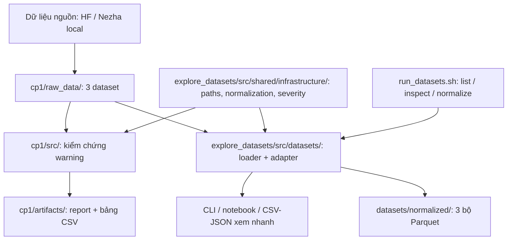

# Resource — RCAEval, LEMMA-RCA và Nezha

Workspace hiện tập trung vào **ba dataset**: `rcaeval`, `lemma_rca`, `nezha`.
Tên folder, registry và output đều dùng ba slug này. Các dataset phụ đã chuyển vào
[`archive/excluded_datasets/`](archive/README.md); dữ liệu và tài liệu nghiên cứu của
ba dataset chính được giữ lại.

## 1. Phân biệt ba nơi dễ nhầm

| Đường dẫn | Chứa gì? | Dùng khi nào? |
| --- | --- | --- |
| `cp1/raw_data/` | Dữ liệu nguồn của cả ba dataset | Đọc log gốc, truy ngược nguồn |
| `explore_datasets/src/datasets/` | Code adapter/loader riêng cho từng dataset | Khám phá và chuẩn hóa |
| `datasets/normalized/` | Dữ liệu đã chuẩn hóa theo schema chung | Đọc bảng Parquet cho bước phân tích tiếp theo |

`cp1/` nghĩa là **Checkpoint 1**, chứa cả raw, code kiểm chứng và report.
`cp1/src/` và `explore_datasets/src/` cùng đọc raw trực tiếp. Cả hai dùng helper
trong `explore_datasets/src/shared/infrastructure/`; các adapter không còn import `cp1_core`.

## 2. Graph dữ liệu và code



Mũi tên từ shared infrastructure biểu thị nơi cung cấp helper cho code xử lý.
Các mũi tên còn lại biểu thị luồng gọi hoặc dữ liệu.

## 3. Cây thư mục

```text
Resource/
├── README.md                       # Bản đồ hiện trạng này
├── README                          # Kế hoạch nghiên cứu gốc
├── PROJECT_MINDMAP.md               # Mindmap nghiên cứu lịch sử
├── cp1/                            # Kiểm chứng dataset
│   ├── config/sources.yaml         # 3 dataset + repo code tham khảo RCAEval
│   ├── raw_data/                   # Raw được giữ nguyên
│   │   ├── huggingface/
│   │   │   ├── rcaeval/            # cases.parquet + 3 case logs local
│   │   │   └── lemma_rca/          # 2 ES JSON sample, PPTX, pod_topology
│   │   ├── nezha/                  # fault_list.json + 03_53_log.csv
│   │   ├── manifest.csv            # Lịch sử fetch của dataset được giữ
│   │   └── README.md
│   ├── src/
│   │   ├── main_RCAEval.py         # fetch/inspect/scan-warnings/timing/verify/all
│   │   ├── main_LEMMA_RCA.py       # fetch/inspect/all
│   │   ├── main_Nezha.py           # inspect local; chưa có downloader Nezha
│   │   └── cp1_core/              # IO, analysis, reporting, registry, fetchers
│   ├── artifacts/
│   │   ├── rcaeval/               # reports/ + tables/
│   │   └── lemma_rca/             # reports/inspect.txt
│   ├── external_repos/github/     # Đích clone repo tham khảo RCAEval
│   ├── docs/                      # Định hướng, schema notes, thuật ngữ, migration
│   ├── tests/fixtures/            # Test và CSV nhỏ/golden counts
│   └── legacy/                    # Script/output lịch sử phục vụ đối chiếu
├── explore_datasets/
│   ├── run_datasets.py             # CLI chung, được run_datasets.sh ở root gọi
│   ├── run_lemma.sh                # Menu/CLI chi tiết LEMMA
│   ├── run_lemma_rca.py             # Wrapper Python cho CLI LEMMA
│   ├── extract_lemma_logs.py        # Tiện ích lọc log/DataFrame
│   ├── audit_datasets.py            # In schema raw của 3 dataset
│   ├── export_all_normalized.py     # Wrapper normalize all, không chạy khi import
│   ├── src/
│   │   ├── interface/datasets_cli.py # Ghép 3 adapter vào CLI chung
│   │   ├── datasets/
│   │   │   ├── rcaeval/            # adapter.py + tests; các layer khác là sườn
│   │   │   ├── lemma_rca/          # domain/application/infrastructure/interface
│   │   │   │                      # cùng notebooks/ và tests/
│   │   │   ├── nezha/              # adapter.py + tests; các layer khác là sườn
│   │   │   └── _template/          # Sườn tham khảo; không phải dataset đang chạy
│   │   ├── shared/
│   │   │   ├── domain/            # canonical.py, ports.py, model profile
│   │   │   ├── application/       # Profiling: shape/columns/head/value_counts
│   │   │   ├── infrastructure/    # Helper chung cho adapter và CP1
│   │   │   │   ├── loaders.py     # Đọc CSV/JSON/Parquet
│   │   │   │   ├── paths.py       # Đường dẫn raw/normalized
│   │   │   │   ├── normalization.py # Chuẩn hóa message
│   │   │   │   └── severity.py    # Nhận diện mức log
│   │   │   └── interface/         # profile_cli.py nhận đường dẫn file bất kỳ
│   │   ├── docs/                  # Protocol khám phá, kiến trúc, thêm dataset
│   │   └── legacy/                # explore_v0.py lịch sử
│   ├── tests/                      # Canonical validation + hồi quy CLI/path/export
│   ├── output/                     # CSV/JSON mẫu đã xuất từ LEMMA
│   ├── requirements.txt
│   └── .venv/                      # Môi trường Python local hiện có
├── datasets/normalized/
│   ├── rcaeval/                    # incidents, log_events, ground_truth.parquet
│   ├── lemma_rca/                  # Tên LEMMA duy nhất sau khi gộp bản trùng
│   └── nezha/                      # Cùng 3 bảng Parquet
├── docs/
│   ├── dataset_audit.md            # Đối chiếu schema raw
│   ├── validation_report.md        # Kết quả kiểm tra và giới hạn hiện tại
│   └── history/                    # Báo cáo validation trước refactor
├── report/                         # Bản thảo LaTeX/DOCX và bibliography
├── requirement/                    # Đề xuất nghiên cứu + fact check
├── note/                           # Nhật ký nghiên cứu
├── archive/excluded_datasets/      # Code/raw/report dataset phụ, ngoài workflow/test
├── conftest.py                     # Thiết lập import cho suite test
├── pytest.ini                      # Chỉ thu thập test của workspace đang dùng
├── requirements.txt                # Dependency CP1
└── setup.ps1                       # Setup Windows cho CP1
```

`.cache/`, `.pytest_cache/`, `__pycache__/` là dữ liệu công cụ sinh ra.
`.vscode/` là cấu hình editor. `.kilo/worktrees/` là bản sao dự án do công cụ quản lý,
không thuộc source/test đang dùng; tránh tìm kiếm trong đó khi đọc code.
CP1 có thể tạo các thư mục `tables/`, `reports/`, `runs/` rỗng khi ghi artifact.

## 4. Chạy từ root repository

Không cần tự cấu hình `PYTHONPATH` cho các wrapper dưới đây.
`run_datasets.sh` chọn Python từ `.venv` local nếu có.

```bash
# Danh sách dataset và đường dẫn; kiểm tra file local mà không tải/ghi lại raw
bash run_datasets.sh list
bash run_datasets.sh inspect all
bash run_datasets.sh inspect nezha

# Xem/lọc log LEMMA bằng CLI chi tiết đã có
bash run_lemma_rca.sh logs --service productpage --limit 5
bash run_lemma_rca.sh profile --limit 1000

# Tạo lại normalized: ghi vào <output-root>/<slug>/
bash run_datasets.sh normalize all --output-root /tmp/normalized-preview
bash run_datasets.sh normalize lemma_rca --output-root /tmp/normalized-preview

# Không chỉ định --output-root sẽ ghi vào Resource/datasets/normalized/<slug>/
# Có thể thay raw bằng --data-root khi chọn một dataset, không dùng với all.
```

Python tương đương:

```bash
Resource/explore_datasets/.venv/bin/python Resource/explore_datasets/run_datasets.py inspect all
Resource/explore_datasets/.venv/bin/python Resource/explore_datasets/export_all_normalized.py --output-root /tmp/normalized-preview
```

Các đường dẫn mặc định được neo theo vị trí source trong
[`shared/infrastructure/paths.py`](explore_datasets/src/shared/infrastructure/paths.py), không phụ thuộc thư mục terminal.
CP1 vẫn đọc [`sources.yaml`](cp1/config/sources.yaml) cho fetch/inspect.
Các file `dataset.yaml` mô tả nguồn/mapping, chưa phải cấu hình tự động của loader;
đổi input runtime bằng `--data-root`/`data_root`.

Setup Linux khi chưa có môi trường:

```bash
python3 -m venv Resource/explore_datasets/.venv
Resource/explore_datasets/.venv/bin/python -m pip install -r requirements.txt
```

`requirements.txt` ở root trỏ tới bộ dependency khám phá. `Resource/requirements.txt`
là bộ CP1 riêng. `Resource/setup.ps1` là setup Windows cũ, yêu cầu Python 3.12 và tạo
`Resource/.venv`; wrapper Bash cũng nhận diện môi trường này trên Linux.

## 5. Đọc output nào?

| Đường dẫn/file | Ý nghĩa |
| --- | --- |
| `cp1/artifacts/<slug>/reports/` | Kết quả inspect/quét warning, không phải raw |
| `cp1/artifacts/rcaeval/tables/` | Bảng thống kê warning/timing/verification |
| `datasets/normalized/<slug>/incidents.parquet` | Danh mục incident/case |
| `datasets/normalized/<slug>/log_events.parquet` | Log schema chung, có raw message và tham chiếu nguồn |
| `datasets/normalized/<slug>/ground_truth.parquet` | Nhãn root cause cho đánh giá |
| `explore_datasets/output/` | CSV/JSON xem nhanh, khác schema canonical Parquet |

Ba bảng Parquet nối bằng `incident_id`; schema nằm ở
[`canonical.py`](explore_datasets/src/shared/domain/canonical.py).
Ví dụ đọc file hiện có từ root repository:

```python
import pandas as pd

logs = pd.read_parquet("Resource/datasets/normalized/rcaeval/log_events.parquet")
print(logs[["incident_id", "timestamp_utc", "service_id", "severity", "raw_message"]].head())
```

Chưa có pipeline gom nhóm/baseline tự động lấy normalized làm đầu vào trong source
hiện có. Đây là lớp dữ liệu chuẩn bị cho bước tiếp theo.

## 6. Phạm vi local và giới hạn cần biết

| Dataset | Incident metadata | Log local/normalized hiện có | Phạm vi |
| --- | ---: | ---: | --- |
| RCAEval | 735 | 405.960 | 3 case có log local |
| LEMMA-RCA | 4 scenario | 20.000 | 2 JSON sample, normalized đang gắn 1 scenario |
| Nezha | 24 | 4.136 | 1 CSV local, normalized chỉ export incident đầu tiên |

Refactor giữ logic parse/normalize và dữ liệu hiện có. Hai giới hạn trước đó vẫn còn:

- LEMMA adapter gán log tìm được vào scenario đầu tiên, chưa lọc thời gian; sample
  tháng 05/2021 không khớp scenario đầu tiên năm 2022. Cần sửa segmentation trước khi
  dùng nhãn để đánh giá RCA.
- CSV/JSON từ CLI LEMMA dùng schema khám phá và cột `root_cause` gán theo tên service;
  đây không phải bộ nhãn incident đã xác minh. Nó cũng có fallback level `INFO`,
  khác canonical adapter cho phép severity `null`.

Xem chi tiết kiểm chứng tại [`docs/validation_report.md`](docs/validation_report.md).
Khi normalize lại, `source_file` thống nhất tương đối với root repository; nếu dùng
raw ngoài repository thì tương đối với `data_root`. Các Parquet cũ được giữ nguyên.

## 7. Những gì đã dọn

- GAIA: chuyển module, notebook, test và raw sang archive; bỏ khỏi registry đang dùng.
- LogHub2, OpsEval, CorrelatedAlerts, Suricata CTU-13: chuyển entrypoint/report còn có
  sang archive; provenance cũ cũng được lưu tại đó.
- Gộp `normalized/lemma/` vào `normalized/lemma_rca/` sau khi xác nhận cả 3 cặp file
  giống byte bằng SHA-256; bỏ symlink tự trỏ `lemma -> lemma` bị lỗi.
- Helper dùng chung nằm trong `explore_datasets/src/shared/infrastructure/`; `cp1_core.normalization/severity`
  giữ export tương thích cho code/test cũ.
- Script export chạy từ mọi working directory, chỉ chạy khi được gọi làm chương trình.
- Tài liệu nghiên cứu, raw, artifact và legacy liên quan ba dataset chính được giữ.

## 8. Kiểm thử

```bash
Resource/explore_datasets/.venv/bin/python -m pytest -c Resource/pytest.ini -q
```

Suite bao gồm CP1, ba adapter, canonical validation và kiểm tra wrapper/path/export.
Archive và worktree Kilo không được thu thập. Một số test adapter cần dữ liệu local
đang có; kết quả hiện tại được ghi trong validation report.
