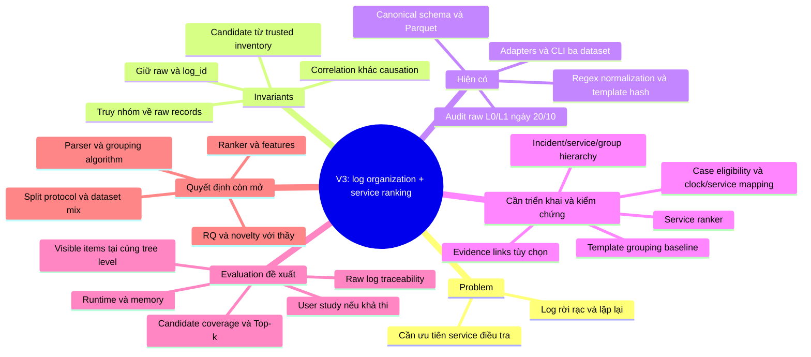

# Project Mindmap — V3 Log Organization & Service RCA

**23/10/2026, working direction chưa được người hướng dẫn duyệt.** [Master context](../../NCKH_MASTER_CONTEXT_2026-10-23.md) là nguồn scope chuẩn. [Mindmap V1](../history/resource_docs/PROJECT_MINDMAP_V1.md) được giữ để đối chiếu.

Luồng dự kiến: **audit → canonical data → parsing/grouping → hierarchy → optional relationships → ranking → held-out evaluation**. Có adapter chưa có nghĩa grouping/ranker đã hoàn thành.

Raw thật: `data/raw/`, cũng là default của code từ 25/10. [repo map](../README.md) và [implementation status](../status/implementation_status.md) ghi hướng dùng `--data-root` và giới hạn export.

Không mặc định WARNING-only, LLM Agent, failure prediction hoặc target lịch sử. Chưa có kết quả Top-k/Traceability/Visible Log Reduction V3; không dùng sơ đồ này như báo cáo tiến độ thực nghiệm.
