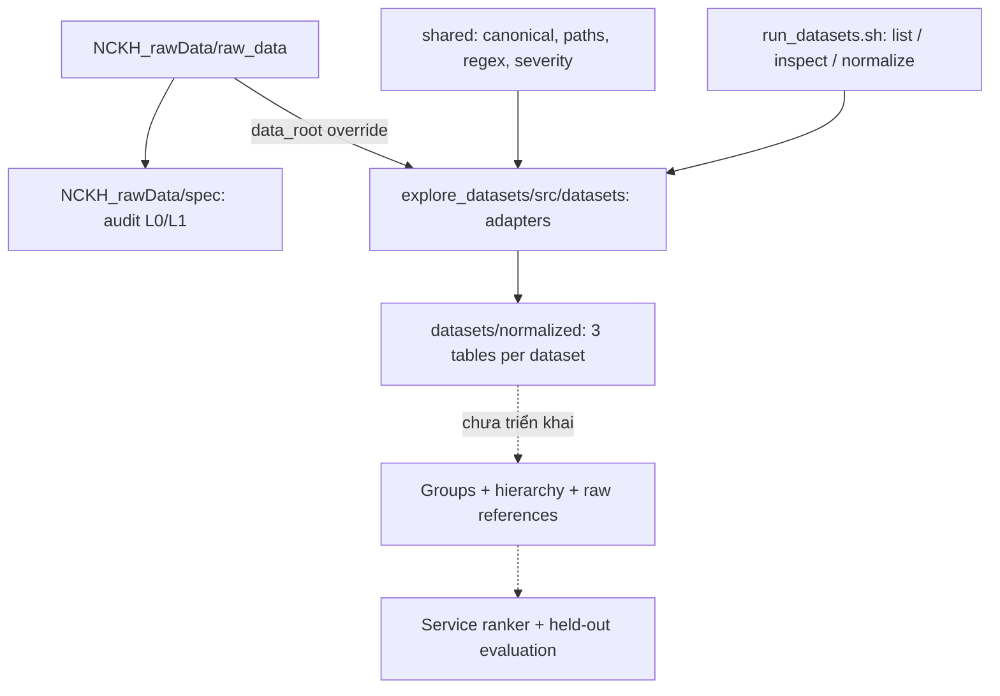

# Resource — bản đồ source, dữ liệu và nghiên cứu V3

**Cập nhật 23/10/2026.** Scope chuẩn: [master context](../../NCKH_MASTER_CONTEXT_2026-10-23.md). Workspace có ba dataset adapters: `rcaeval`, `lemma_rca`, `nezha`; chưa có pipeline grouping/ranking V3 hoàn chỉnh.

## 1. Phân biệt nơi lưu

| Đường dẫn từ root repository | Nội dung | Trạng thái |
| --- | --- | --- |
| `NCKH_rawData/raw_data/` | Raw RCAEval/LEMMA-RCA/Nezha, manifest cũ | Có thật, giữ nguyên |
| `NCKH_rawData/spec/` | Audit metadata, L1 evidence/ledger, dataset plan và test | Artifact 20/10; chưa là bảng eligibility RCA hoàn chỉnh |
| `Resource/explore_datasets/src/` | Adapter/loader/canonical schema/CLI | Source active |
| `Resource/datasets/normalized/<slug>/` | Ba bảng `incidents`, `log_events`, `ground_truth` | Có thật, footer kiểm tra lại 23/10 |
| `Resource/cp1/raw_data/` | Raw mặc định mà `paths.py` đang cấu hình | **Không có trong checkout này** |
| `Resource/cp1/`, `cp2/`, `archive/` | Cấu trúc từng ghi trong docs cũ | Không có trong workspace active; không lấy worktree công cụ thay thế |

## 2. Luồng dữ liệu thực tế và phần dự kiến



Mũi tên adapter→normalized biểu diễn khả năng có trong source. Không có run manifest chứng minh mọi file hiện hữu đều được tạo bởi đúng revision code này. Code path mặc định vẫn cần override.

## 3. Source hiện có

```text
Resource/
├── explore_datasets/
│   ├── run_datasets.py             # CLI chung
│   ├── run_lemma_rca.py            # CLI exploration LEMMA
│   ├── export_all_normalized.py    # Wrapper normalize all
│   ├── audit_datasets.py           # Script audit cũ, khác audit trong spec/
│   ├── extract_lemma_logs.py       # Helper khám phá LEMMA
│   ├── src/
│   │   ├── interface/datasets_cli.py
│   │   ├── datasets/
│   │   │   ├── rcaeval/infrastructure/adapter.py
│   │   │   ├── nezha/infrastructure/adapter.py
│   │   │   ├── lemma_rca/          # domain/application/loader/downloader/CLI
│   │   │   └── _template/          # Sườn, không có trong registry runtime
│   │   ├── shared/                # canonical/ports/profiling/loaders/paths/regex
│   │   ├── docs/                  # Architecture, exploration, thêm dataset
│   │   └── legacy/                # Không dùng cho workflow mới
│   └── tests/                     # Canonical + CLI/path/export checks
├── datasets/normalized/{rcaeval,lemma_rca,nezha}/
├── docs/                          # Status/audit/validation/protocol/history
├── note/                          # Handoff và training design
├── report/                        # Bản thảo V1 LaTeX/DOCX
├── requirement/                   # Lý do/fact-check lịch sử V1
├── PROJECT_MINDMAP.md              # Mindmap V3
├── README                         # Kế hoạch V1 được đánh dấu lịch sử
├── conftest.py
└── pytest.ini                     # Còn nhắc cp1/tests không hiện diện
```

## 4. Lệnh và môi trường

Từ root repo:

```bash
bash run_datasets.sh --help
bash run_datasets.sh list
bash run_datasets.sh inspect rcaeval --data-root NCKH_rawData/raw_data/huggingface/rcaeval
```

`inspect rcaeval` đọc toàn bảng metadata `cases.parquet`, không đọc toàn bộ log; không cần chạy khi chỉ cập nhật docs. `inspect lemma_rca` liệt kê file và kịch bản hard-code, chưa xác minh nhãn nguồn. `inspect nezha` đếm faults từ fault list đầu tiên, không phải tổng nhiều ngày.

```bash
# Nếu cần kiểm tra từng nguồn khác
bash run_datasets.sh inspect lemma_rca --data-root NCKH_rawData/raw_data/huggingface/lemma_rca
bash run_datasets.sh inspect nezha --data-root NCKH_rawData/raw_data/nezha

# Ví dụ tạo output mới; có đọc dữ liệu log, không thuộc kiểm tra docs
bash run_datasets.sh normalize rcaeval \
  --data-root NCKH_rawData/raw_data/huggingface/rcaeval \
  --output-root /tmp/nckh-normalized-preview
```

`--output-root` là thư mục cha, adapter viết vào `<output-root>/<slug>/`. Không truyền thì ghi đè nơi canonical mặc định. `--data-root` chỉ dùng với **một dataset**, không dùng cùng `all`. `dataset.yaml` là mô tả, không tự cấu hình loader. CLI LEMMA chi tiết: `bash run_lemma_rca.sh --help`; kiểm tra cờ `--data-root` ở cấp command trước khi dùng, không mặc định raw CP1 vẫn tồn tại.

Môi trường local hiện có: `Resource/explore_datasets/.venv/bin/python`, với pandas/pyarrow/pytest. `python3` hệ thống ở lần kiểm tra này thiếu cả ba thư viện. Nếu cần môi trường mới, dùng root `requirements.txt` như [README](../../README.md).

## 5. Canonical data và giới hạn export

Schema thật tại [canonical.py](../../src/shared/domain/canonical.py). Event dùng `log_id`, giữ `raw_message`, `source_file`, `source_row_id`, `raw_record_ref`; nhãn có bảng `ground_truth` riêng. `incidents` vẫn có `raw_label`/`fault_type`, vì vậy tách bảng **chưa đủ** chống leakage.

| Adapter | Hành vi export hiện tại | Giới hạn |
| --- | --- | --- |
| RCAEval | Metadata/GT toàn bộ; logs mặc định `max_cases=30`, chọn theo system | PyArrow writer theo case nhưng `load_logs()` vẫn nạp nguyên case |
| LEMMA-RCA | 4 scenario hard-code; tối đa `limit_per_incident=50000` | Multi-target bị rút còn một canonical target; alignment cần audit |
| Nezha | Metadata đa ngày; logs chỉ incident đầu tiên | Vòng lặp fault có lệch indentation; cần xác minh số incident và duplicate |

Không có module groups/tree/relationships/ranker V3 trong source active. MD5 của chuỗi regex-normalized là template key hiện có, chưa là parser Drain3/Spell đã đánh giá. Xem [implementation status](../status/implementation_status.md).

## 6. Validation và công việc tiếp theo

[Validation report](../status/validation_report.md) tách kết quả footer mới khỏi báo cáo 32/32 test ngày 19/10. Full suite hiện có test phụ thuộc raw path CP1 và entrypoint đã vắng mặt, nên không gắn nhãn “100% pass” cho checkout này.

Tiếp theo: lập case eligibility đáng tin; xử lý path/mapping/window/provenance gaps; khóa split; triển khai baseline grouping và hierarchy trước ranker. [Research protocol](../research/research_protocol_v3.md) ghi rõ các output còn là đề xuất và những quyết định chưa chốt.
